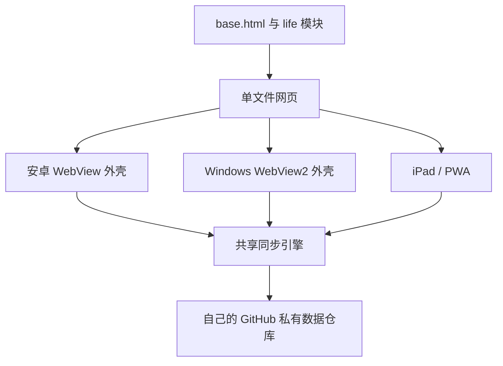

# 架构与数据

核心是共享的网页应用。构建时把当前功能模块按顺序嵌入基础模板，生成单文件，再由各端添加自己的适配。没有项目自建的账号服务器；可选同步使用用户自己的私有 GitHub 仓库。

## 数据关系

| 数据 | 用途 |
| --- | --- |
| `goals` | 顶层愿望，兼容旧的 `skills/actions` 和新的 `nodes` |
| `nodes[].parents` | 用父节点 ID 表示拆解路径，支持多条上层路径 |
| `networkRelations` | 跨分支的 `supports` / `enables` 关联，保留方向和理由 |
| `placements` | 某个行动在某一天的安排，含排序和完成状态 |
| `logs` | 已经行动的记录，取消完成可撤回对应记录 |
| `evidence` | 对行动结果的补充、链接或证据 |
| `ideas` | 灵感、补充内容、文件与灵感行动 |
| `chores` | 不一定属于生活主线的日常任务 |

`model.js` 将兼容结构整理成统一索引。层级列表只根据结构路径展开；关联不会凭空变成父子分支。用户手动选择关联时应继续使用原节点，避免为表达关联而复制内容。

普通行动必须没有结构子节点；导入网络的行动还要符合导入标记中的末端资格。`network-import.js` 中的 `canSchedule` 是层级列表安排行动的共同判断入口。导入是追加合并，不自动把所有行动排进今天，不把“预期证据”当作已完成记录。

## 界面入口

`tree.js` 负责层级列表；`semantic.js`、`force.js`、`gestures.js` 等负责图谱的呈现与交互；`browse.js` 管理主动打开详情；`simple.js` 接入简洁操作界面。多数状态变化通过现有保存入口落盘，然后刷新相关视图。

## 存储与同步

- 单文件版主要使用浏览器本地存储及附件数据库，适合体验。原生与 PWA 添加各自的持久保存适配。
- PWA 使用 `web/vault.js` 访问 IndexedDB，本机缓存用于离线加载。系统清理网站数据会影响它，安装到主屏幕不等于永久备份。
- 安卓和 Windows 各自有本机存档与文件实现，源码中可以看到备份、恢复和桥接边界。
- `sync/core.js` 提供共享格式校验与三方合并；`sync/engine.js` 通过适配器调用设备存储和 GitHub。
- 独立改动可以合并；同一记录的冲突不会随便覆盖，需选择。连接密钥不属于项目数据备份，也不应提交源码。

源码公开仓库与用户私有同步仓库是不同用途。多个安装用户默认互不关联；相同程序不代表相同本机存储或同步账号。
